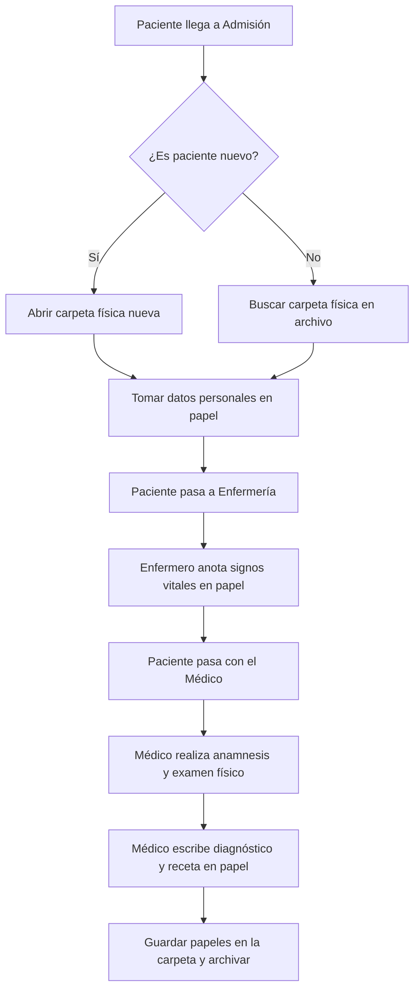
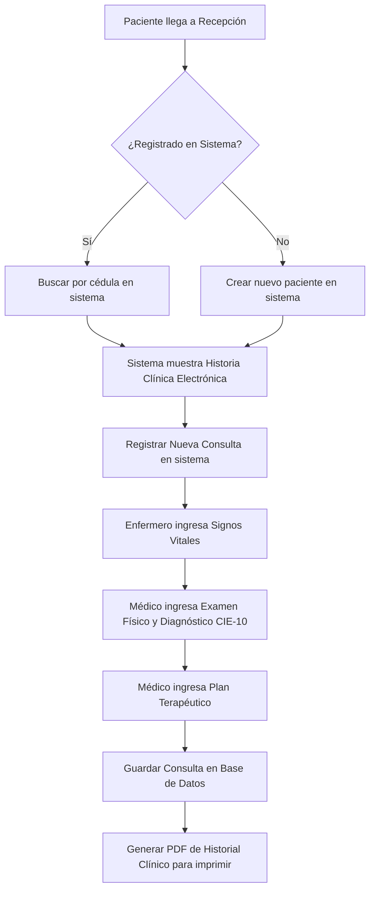

# Documentación Técnica: Historia Clínica Electrónica Web (Medicina General)

## 1. Objetivos
- **Objetivo General:** Diseñar e implementar una Historia Clínica Electrónica Web funcional que permita registrar pacientes, gestionar antecedentes clínicos, almacenar múltiples consultas médicas y generar reportes clínicos digitales mediante una arquitectura compuesta por frontend, backend y base de datos relacional.
- **Objetivos Específicos:**
  - Desarrollar el módulo de gestión de pacientes (CRUD).
  - Implementar el registro de consultas médicas con datos específicos de Medicina General (Signos Vitales, Examen Físico Regional, Diagnóstico y Tratamiento).
  - Consolidar un historial clínico centralizado.
  - Implementar la generación de reportes en formato PDF.
  - Orquestar la solución utilizando Docker.

## 2. Requerimientos
### 2.1 Requerimientos Funcionales
- El sistema debe permitir registrar, editar y listar pacientes, validando que no existan duplicados (Cédula y N° Historia Clínica).
- El sistema debe permitir el registro de Antecedentes (Personales, Familiares, Patológicos, Quirúrgicos, Alergias, etc.).
- El sistema debe permitir agregar múltiples Consultas Médicas a una sola Historia Clínica.
- La consulta médica debe registrar el Examen Físico Regional detallado.
- El sistema debe generar un archivo PDF con todo el historial médico del paciente listo para imprimir.

### 2.2 Requerimientos No Funcionales
- Arquitectura basada en cliente-servidor mediante API REST.
- Frontend desarrollado con React (Vite).
- Backend desarrollado con Java Spring Boot.
- Base de datos relacional MySQL.
- Sistema contenedorizado utilizando Docker y Docker Compose.
- Interfaz gráfica premium con colores elegantes, animaciones sutiles y diseño responsive.

## 3. Diagrama de Flujo

### 3.1 Diagrama AS-IS (Proceso Manual Actual)


### 3.2 Diagrama TO-BE (Proceso Sistematizado Propuesto)


## 4. Casos de Uso UML
```mermaid
usecaseDiagram
    actor "Recepcionista" as R
    actor "Enfermero" as E
    actor "Médico General" as M

    R --> (Registrar Paciente)
    R --> (Buscar Paciente)
    
    E --> (Buscar Paciente)
    E --> (Registrar Signos Vitales)
    
    M --> (Buscar Paciente)
    M --> (Ver Historial Clínico)
    M --> (Registrar Examen Físico)
    M --> (Registrar Diagnóstico CIE-10)
    M --> (Registrar Tratamiento)
    M --> (Generar PDF de Historia Clínica)
```

## 5. Arquitectura
El sistema sigue una arquitectura de 3 capas contenedorizada:
- **Capa de Presentación:** Aplicación SPA (Single Page Application) en React servida por Nginx.
- **Capa de Negocio:** API REST desarrollada en Java con Spring Boot, expuesta en el puerto 8080. Utiliza Hibernate/JPA para ORM y OpenPDF para generación de documentos.
- **Capa de Datos:** Base de datos MySQL 8.0 persistida en volúmenes Docker.

## 6. Diagrama Entidad-Relación
El modelo de datos se basa en el archivo `nuevo.sql`. Las relaciones principales son:
- **PACIENTE (1) -> (1) HISTORIA_CLINICA**
- **PACIENTE (1) -> (N) ANTECEDENTES**
- **HISTORIA_CLINICA (1) -> (N) CONSULTA_MEDICA**
- **CONSULTA_MEDICA (1) -> (1) SIGNOS_VITALES**
- **CONSULTA_MEDICA (1) -> (N) EXAMEN_FISICO**
- **CONSULTA_MEDICA (1) -> (N) DIAGNOSTICOS**
- **CONSULTA_MEDICA (1) -> (N) TRATAMIENTOS**

## 7. Conclusiones
La implementación del sistema de Historia Clínica Electrónica Web para Medicina General permite centralizar y digitalizar eficientemente la información médica de los pacientes. La arquitectura elegida garantiza alta disponibilidad y portabilidad mediante el uso de Docker, mientras que React y Spring Boot ofrecen un rendimiento óptimo y mantenibilidad a largo plazo.
